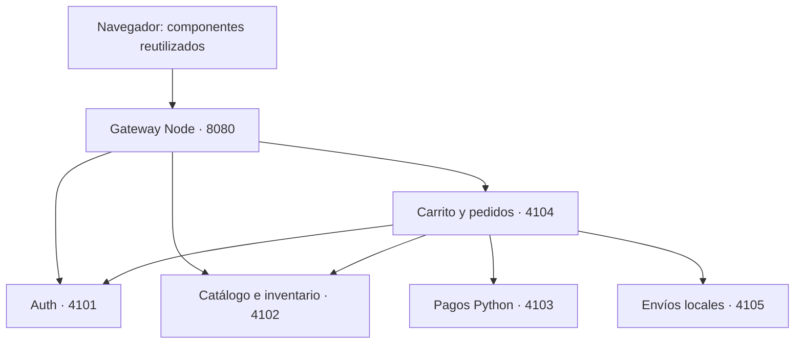
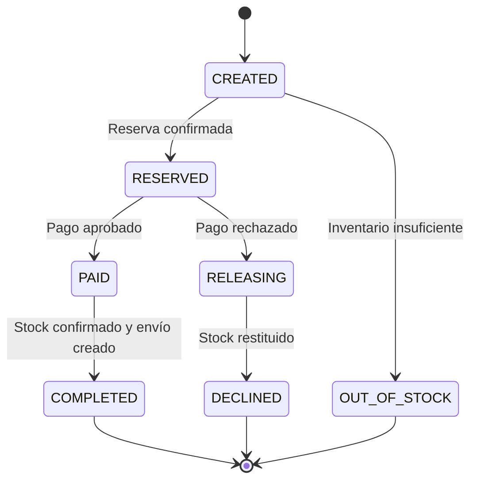

# Arquitectura integrada

Se conserva el contrato `GET /api/productos` con envoltorio `{success,data}` y las funciones del servicio de inventario original. Un adaptador ejecuta sus consultas sobre SQLite. La lógica de autenticación del ZIP se reutiliza con repositorio SQLite, utilidades scrypt/JWT y un adaptador HTTP nuevo. Las reglas de marca/Luhn/aprobación de Python son las del simulador aportado; su transporte y persistencia son nuevos.

Cada servicio tiene su archivo de datos; ningún servicio abre la base de otro. Las llamadas HTTP internas tienen timeout y clave de servicio. El navegador utiliza el mismo origen del gateway, sin configurar cinco URLs ni abrir CORS global.

## Proceso de compra

1. Verificar JWT mediante Auth y obtener el usuario del servidor.
2. Bajo una cola por usuario, validar domicilio, token de prueba y clave de idempotencia.
3. Buscar pedido anterior por `(usuario, clave)`. Si cambia domicilio/token, devolver 409. Si existe con la misma solicitud, continuar su estado o devolver su resultado.
4. Leer carrito y catálogo, calcular subtotal/envío y guardar un snapshot durable del pedido.
5. Reservar todo el stock en una transacción SQLite `BEGIN IMMEDIATE`. Si una línea falla, se revierte toda la reserva.
6. Ejecutar pago con `id=pedido`. El servicio de pagos guarda una sola respuesta por ID y rechaza reutilización con otro importe/token.
7. Si se rechaza, liberar la reserva idempotentemente. Si se aprueba, confirmar la reserva y crear el envío idempotente.
8. Guardar `COMPLETED` y vaciar carrito en una sola transacción local.

Un error de transporte conserva el estado y `error`. El worker reintenta pasos no terminales cada 4 segundos, también después de reiniciar. Los estados y sus datos de pago/envío se escriben conjuntamente. Un fallo entre respuesta remota y escritura local se resuelve repitiendo el paso con el mismo ID.

No hay expiración automática de reservas: una indisponibilidad prolongada de pagos o envíos requiere restaurar el servicio y dejar actuar la recuperación. No liberar manualmente una reserva pagada. El proceso local garantiza idempotencia bajo un solo coordinador; no es un sistema de consenso entre múltiples réplicas.

## Validaciones y dinero

Cantidades enteras 1–99 (0 elimina línea), precios e importes en centavos, snapshots del producto al comprar, stock no negativo, token de pago en lista cerrada. Los importes del cliente no se utilizan. Las reseñas requieren una compra confirmada. Pedidos, carritos y devoluciones se filtran por usuario autenticado. Las contraseñas se guardan con scrypt y sal individual; se conserva el bloqueo tras cinco intentos fallidos del servicio original.

## Componentes de interfaz

- `header.js`: Web Component original con nombre de usuario renderizado mediante textContent, eventos `login-click`, `cart-click` y `logo-click` conectados al router.
- `menu.js` y `menu.css`: biblioteca original, enlaces a categorías funcionales.
- `footer.js`: Web Component original y sus slots, con enlaces a pedidos y ayuda.
- `domicilio.js`: adaptación de campos y validación del HTML original. Ya no usa una libreta global de `localStorage`; se envía como domicilio del pedido.
- `app.js`: router por hash, catálogo, detalle, sesión, carrito, pago, pedidos y formularios nuevos.
- Ilustraciones SVG locales: no necesitan proveedores de imágenes ni conexión a Internet.

## Administración local del catálogo

La tienda no tiene registro de administradores público. El operador del repositorio promueve explícitamente un usuario registrado con `npm run admin -- promote NOMBRE_USUARIO`. Las APIs de panel verifican `rol=ADMIN` consultando Auth en cada solicitud; la clave de servicio se mantiene dentro del clúster local. Crear y editar productos cruza HTTP desde Comercio a Inventario. Imágenes PNG/JPEG/WebP se redimensionan en el navegador, se valida su formato en Inventario y se guardan en `data/product-images`; el gateway sirve únicamente nombres de imagen generados. `DELETE` es retiro lógico, y Comercio rechaza productos presentes en carritos o pedidos históricos.
